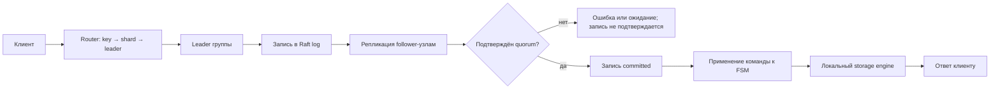

# SHARDLINE

## Техническое задание и учебный маршрут

**Проект:** распределённая key-value storage system на Go\
**Назначение:** изучение backend engineering, storage internals и
distributed systems\
**Формат:** последовательная реализация с проверяемыми результатами
каждого этапа

------------------------------------------------------------------------

## 0. Идея проекта

Shardline --- распределённое хранилище пар `key → value`, которое
состоит из нескольких Go-процессов (узлов).

Клиент отправляет запрос:

``` text
PUT user:42 "Dan"
GET user:42
DELETE user:42
```

Система должна самостоятельно: - принимать сетевые запросы; - хранить
данные на диске и восстанавливаться после перезапуска; - распределять
данные по shard'ам; - реплицировать изменения между узлами; -
согласовывать порядок изменений; - переживать падение отдельных узлов; -
догонять отставшие реплики после восстановления.

**Главная учебная цель:** понять, как из обычного Go-сервиса постепенно
получается распределённая инфраструктурная система.

Это не CRUD-приложение и не HTTP-обёртка над готовой БД. Основные
механизмы хранения, сетевого взаимодействия и консенсуса реализуются
самостоятельно.

### Что именно изучаем

1.  Go как язык backend-разработки: пакеты, интерфейсы, ошибки,
    контекст, тестирование.
2.  Сетевое программирование: TCP, протоколы, framing, таймауты,
    соединения.
3.  Конкурентность: goroutines, mutexes, атомарность, гонки, shutdown.
4.  Хранение данных: WAL, memtable, SSTable, индексы, compaction.
5.  Распределённые системы: репликация, Raft, leader election,
    partitioning.
6.  Эксплуатация backend-систем: конфигурация, логи, метрики,
    профилирование, fault injection.

### Как читать этот документ

В каждом этапе есть блок **«Зачем этот этап»** с объяснением идеи и
вопросом для самопроверки. Сначала прочитай пояснение и материалы,
затем реализуй небольшой результат и проверь его по критерию «Готово,
когда». Если не можешь ответить на вопрос самопроверки, вернись к
примеру или документации до перехода дальше.

В списках чтения метки означают: **Основа** — прочитать для понимания
этапа; **Справочник** — использовать при реализации; **Дополнительно**
— углублённое чтение. Язык источника указан как **RU** или **EN**.
Перевод книги может отличаться по названию и нумерации глав.

------------------------------------------------------------------------

## 1. Границы проекта

Чтобы проект оставался сложным, но выполнимым, вводим ограничения.

### В первой версии делаем

-   Go, несколько независимых процессов.
-   Собственный бинарный TCP-протокол.
-   Собственный локальный KV storage engine.
-   WAL и восстановление после перезапуска.
-   LSM-подобное хранение: memtable + SSTable.
-   Несколько Raft-групп, по одной на shard.
-   По три реплики в каждой Raft-группе.
-   Запись через leader соответствующей группы.
-   Фиксированное распределение shard'ов между узлами.
-   Тестирование падений, перезапусков и сетевых проблем.

### Пока НЕ делаем

-   SQL, транзакции между разными shard'ами и secondary indexes.
-   Динамическое добавление/удаление узлов в production-режиме.
-   Автоматический rebalance данных.
-   Multi-region и геораспределённые кластеры.
-   Exactly-once выполнение произвольных пользовательских действий.
-   Собственный язык запросов.
-   Совместимость с Redis или Cassandra.

Эти ограничения не упрощают главную задачу. Они позволяют сначала
корректно реализовать один законченный distributed vertical slice.

### Модель распределения

Ключ отображается в shard:

``` text
shard_id = hash(key) % shard_count
```

Каждый shard обслуживается отдельной Raft-группой из трёх реплик. У
группы есть один действующий leader и две follower-реплики.

Raft обеспечивает согласованный replicated log **внутри одной группы**.
Разные shard'ы пока независимы: атомарной транзакции сразу между ними
нет.

Для первой версии конфигурация кластера статическая. Перераспределение
shard'ов и изменение состава Raft-групп --- отдельные поздние этапы.

### Путь записи в готовой системе



Схема показывает целевой путь для PUT/DELETE одного shard'а. Raft log
согласует порядок команд между репликами, а storage engine хранит
состояние FSM локально; это два разных журнала с разными задачами. Если
клиент не получил ответ из-за таймаута, команда уже могла стать
committed, поэтому повторный запрос обрабатывается с учётом request ID.
Чтение в первой версии идёт через leader и должно использовать безопасный
механизм, описанный на этапе 9. Raft определяет commit по своим правилам:
quorum необходим, но сам по себе факт копирования записи на большинство
не всегда достаточен.

### Краткий словарь

| Термин | Значение в Shardline |
| --- | --- |
| **Shard** | Часть пространства ключей; для неё выбираются группа реплик и Raft log. |
| **Replica** | Узел, хранящий копию данных и состояния одной Raft-группы. |
| **Leader / follower** | Роли внутри группы: leader принимает команды, follower хранит и применяет согласованный log. |
| **Quorum** | Большинство реплик группы; для трёх реплик это две. |
| **Committed entry** | Команда Raft log, committed по правилам консенсуса, включая требования к quorum и term, и готовая к применению FSM. |
| **FSM** | Детерминированная state machine, которая применяет команды PUT/DELETE в одном порядке на репликах. |
| **Storage WAL** | Локальный append-only журнал для восстановления storage engine; не заменяет Raft log. |
| **Memtable / SSTable** | Изменяемое состояние в памяти и неизменяемый отсортированный файл в LSM-хранилище. |
| **Tombstone** | Маркер удаления, который временно скрывает более старое значение в SSTable. |
| **Snapshot** | Сохранённое состояние FSM, позволяющее восстановиться без повторного проигрывания всего старого log. |
| **Request ID** | Идентификатор запроса, помогающий распознать повтор после таймаута и не применить его дважды. |

------------------------------------------------------------------------

# Часть I. Подготовка: Go и backend fundamentals

## Этап 1. Go для сетевого backend

### Зачем этот этап

Прежде чем собирать storage и сетевой сервер, подготовь основу, на
которой удобно изолировать ошибки и проверять небольшие части системы.
Пакеты задают границы кода, `context` — отмену и сроки операций, а тесты
помогают безопасно менять реализацию по мере усложнения проекта.

**Проверь себя:** можешь ли ты объяснить, кто отменяет операцию с
`context` и чем ошибка «ключ не найден» отличается от ошибки чтения файла?

### Изучить

-   Packages, modules, visibility и организация проекта.
-   Structs, interfaces, composition.
-   Ошибки: wrapping, `errors.Is`, `errors.As`.
-   `context.Context`: cancellation, deadline, propagation.
-   Работа с байтами: `[]byte`, `io.Reader`, `io.Writer`.
-   `encoding/binary`, `encoding/gob` и ограничения сериализации.
-   Файлы: `os`, `io`, `bufio`.
-   Тесты: table-driven tests, subtests, benchmarks.
-   Race detector и базовые правила безопасной конкурентности.

### Почитать

-   **Основа · EN:** [A Tour of Go](https://go.dev/tour/)
    -   Methods and interfaces.
    -   Concurrency.
-   **Основа · EN:** [Go tutorials](https://go.dev/doc/tutorial/) ---
    официальные вводные уроки по модулям, тестам и инструментам.
-   **На русском · RU:** [Go на русском](https://goru.dev/learn) ---
    переводные материалы и ссылки на интерактивный тур; сверяй детали с
    оригинальной документацией.
-   **Дополнительно · EN:** [Effective Go](https://go.dev/doc/effective_go)
    -   Errors.
    -   Concurrency.
-   **Справочник · EN:** [Go blog: Context](https://go.dev/blog/context),
    [пакет `io`](https://pkg.go.dev/io) (`Reader`/`Writer`) и
    [документация пакетов Go](https://pkg.go.dev/).

### Реализовать

1.  Создать репозиторий и разложить код по пакетам.
2.  Написать конфигурацию узла: ID, адрес, директория данных, список
    peer-узлов.
3.  Реализовать загрузку конфигурации и валидацию полей.
4.  Сделать собственный тип ошибки для ошибок хранения/сети.
5.  Написать небольшой файловый модуль: создать файл, записать данные,
    прочитать, обработать повреждённый/отсутствующий файл.
6.  Добавить unit-тесты и запуск `go test -race ./...`.

**Микрохинты** - Не делай один огромный `package main`. - Не превращай
каждую структуру в интерфейс «на будущее». - Ошибки должны объяснять,
какая операция и над каким ресурсом завершилась неудачно. -
`context.Context` передавай первым аргументом публичных операций,
которым нужна отмена.

**Готово, когда:** проект собирается, конфигурация валидируется, ошибки
тестируются, race detector проходит.

------------------------------------------------------------------------

# Часть II. Один узел: собственное хранилище

## Этап 2. Базовый KV engine в памяти

### Зачем этот этап

Сначала зафиксируй смысл `Get`, `Put` и `Delete` без файлов и сети. Так
последующие WAL и TCP-обработчик будут опираться на ясный контракт, а
не каждый задавать собственное поведение. Mutex защищает общее состояние
от одновременного доступа; tombstone сохраняет факт удаления, который
позже понадобится при чтении старых версий из LSM-файлов.

**Проверь себя:** если `Put(k)` и `Delete(k)` выполняются одновременно,
какое наблюдаемое состояние допустимо и как вызывающий код поймёт, что
ключа нет?

### Изучить

-   Что такое key-value storage.
-   API и контракт операций `Get`, `Put`, `Delete`.
-   Hash map и средняя сложность операций.
-   Mutex, RWMutex и критические секции.
-   Линеаризуемость на уровне одного процесса: что значит, что
    конкурентные операции выглядят как последовательные.
-   Tombstone: почему удаление в LSM-хранилище не всегда означает
    физическое удаление записи.

### Почитать

-   **Основа · EN:** [Go: sync package](https://pkg.go.dev/sync) и
    [Go: maps](https://go.dev/blog/maps).
-   **Дополнительно · EN / RU-перевод:** *Designing Data-Intensive
    Applications*, Martin Kleppmann:
    -   Chapter 1 --- Reliable, Scalable, and Maintainable Applications.
    -   Chapter 3 --- Storage and Retrieval (в первую очередь обзор
        способов хранения).

### Реализовать

1.  Определить минимальный интерфейс хранилища: `Get`, `Put`, `Delete`.
2.  Сделать in-memory реализацию на map.
3.  Защитить map от конкурентного доступа.
4.  Определить поведение для отсутствующего ключа.
5.  Реализовать удаление через tombstone во внутренней модели записи.
6.  Написать тесты на обычные и конкурентные операции.

**Микрохинты** - Сначала зафиксируй семантику API, а уже потом выбирай
структуры данных. - Не возвращай внутренние `[]byte` напрямую, если
вызывающий код сможет их изменить. - Подумай, что должно произойти, если
одновременно идут `Put(k)` и `Delete(k)`.

**Готово, когда:** конкурентные тесты стабильны, `go test -race ./...`
не находит гонок.

------------------------------------------------------------------------

## Этап 3. WAL --- журнал операций

### Зачем этот этап

Map пропадает вместе с процессом. WAL позволяет восстановить её:
операция кодируется в запись журнала, добавляется в файл и затем
применяется к состоянию. При старте журнал проигрывается снова. Политика
`Sync` определяет, какие подтверждённые записи переживут отключение
питания; неполную последнюю запись можно отличить от повреждения в
середине журнала.

**Проверь себя:** в какой момент PUT считается успешным при выбранной
политике синхронизации и что восстановление должно сделать с обрезанным
хвостом WAL?

### Изучить

-   Зачем базе данных write-ahead log.
-   Почему сначала нужно надёжно записать намерение изменить данные, а
    потом менять основное состояние.
-   Append-only files.
-   Record format: длина, тип операции, ключ, значение, checksum.
-   `fsync` и разница между записью в userspace buffer, page cache и
    устойчивым хранением.
-   Crash recovery: что делать с последней неполной записью.
-   Идемпотентное применение операций.

### Почитать

-   **Основа · EN / RU-перевод:** *Designing Data-Intensive Applications*:
    -   Chapter 3 --- Log-structured storage.
-   **Справочник · EN:** [Go `os.File`](https://pkg.go.dev/os#File) и
    [Go `encoding/binary`](https://pkg.go.dev/encoding/binary).
-   **Основа · EN:** [SQLite: Write-Ahead Logging](https://www.sqlite.org/wal.html) ---
    изучить идею и порядок действий, не копировать архитектуру SQLite
    целиком.

### Реализовать

1.  Спроектировать бинарный формат WAL-записи.
2.  Реализовать append операции `PUT` и `DELETE`.
3.  Добавить длину записи и checksum.
4.  Реализовать чтение журнала последовательно.
5.  При старте восстанавливать in-memory состояние проигрыванием WAL.
6.  Обработать EOF и повреждённую последнюю запись.
7.  Добавить режим синхронизации на диск и явно описать его гарантию.
8.  Написать тесты: нормальный restart, пустой файл, обрезанная запись,
    неверная checksum.

**Микрохинты** - Не записывай Go-структуру в файл простым `Write` и не
полагайся на layout памяти. - Формат файла должен быть определён явно:
порядок байтов, размеры полей, версия формата. - Не всякая ошибка чтения
означает «можно молча остановиться». Разделяй допустимый torn tail и
повреждение в середине журнала. - Не называй данные durable, если не
определил, когда вызывается `Sync`.

**Готово, когда:** после закрытия процесса и повторного запуска все
подтверждённые операции восстановлены в соответствии с выбранной
гарантией durability.

------------------------------------------------------------------------

## Этап 4. LSM: Memtable и SSTable

### Зачем этот этап

WAL нужен для восстановления, но сам по себе превращается в длинную
историю записей. LSM добавляет изменяемую memtable для свежих значений и
неизменяемые отсортированные SSTable для сброса на диск. Чтение ищет
ключ в нескольких местах и выбирает самую новую версию; compaction
объединяет файлы и убирает устаревшие версии, когда это безопасно.

**Проверь себя:** если в memtable есть новое значение, а в старой
SSTable — предыдущее, какое должно вернуть `Get` и по какому признаку?

### Изучить

-   Почему случайные записи на диск дорогие.
-   Log-Structured Merge Tree.
-   Memtable --- изменяемая структура в памяти.
-   SSTable --- неизменяемый отсортированный файл.
-   Sorted runs и поиск по нескольким уровням.
-   Sparse index и Bloom filter --- сначала понять назначение,
    реализацию можно отложить.
-   Compaction: слияние файлов и удаление устаревших версий.
-   Tombstones и проблема «воскрешения» удалённых данных.

### Почитать

-   **Основа · EN / RU-перевод:** *Designing Data-Intensive Applications*:
    -   Chapter 3 --- разделы про LSM-trees, SSTables, compaction.
-   **Основа · EN:** [LevelDB implementation
    notes](https://github.com/google/leveldb/blob/main/doc/impl.md)
-   **Дополнительно · EN:** [RocksDB
    overview](https://github.com/meta/rocksdb/wiki/RocksDB-Overview)

### Реализовать

1.  Выбрать структуру memtable. Для первой версии допустима sorted map
    или skip list.
2.  Записывать операции в WAL и обновлять memtable.
3.  При достижении порога сбрасывать memtable в SSTable.
4.  Хранить SSTable в отсортированном формате.
5.  Реализовать поиск ключа в memtable и SSTable.
6.  Корректно выбирать самую новую версию ключа.
7.  Реализовать tombstone в SSTable.
8.  Добавить простую compaction: слить два файла в один, сохранив
    актуальные значения.
9.  Реализовать recovery с учётом WAL и уже созданных SSTable.

**Микрохинты** - SSTable после создания не меняй на месте: считай его
immutable. - У каждой записи должен быть порядок/версия, иначе после
нескольких flush невозможно надёжно определить актуальное значение. -
Продумай crash points: процесс может упасть во время flush или
compaction. - Не удаляй старые файлы, пока новый результат не записан и
не зафиксирован безопасным способом. - Сначала сделай простую compaction
без уровней и сложной политики.

**Готово, когда:** storage выдерживает серию
Put/Delete/flush/compaction/restart и после восстановления возвращает те
же актуальные значения.

------------------------------------------------------------------------

## Этап 5. Надёжность локального storage

### Зачем этот этап

Даже правильные WAL и SSTable могут дать неверный результат, если
процесс упадёт между публикацией нового файла и удалением старого.
Manifest фиксирует, какие файлы составляют актуальное состояние.
Безопасный порядок записи должен оставлять после каждого возможного
сбоя либо прежнее целое состояние, либо новое целое состояние.

**Проверь себя:** что увидит recovery, если процесс упал после записи
нового SSTable, но до обновления manifest?

### Изучить

-   Atomic file replacement и безопасная публикация новых файлов.
-   Manifest / metadata file: как хранить список актуальных SSTable.
-   File lifecycle и удаление старых файлов.
-   Checksums и обнаружение повреждений.
-   Crash consistency: процесс может остановиться между любыми двумя
    шагами.
-   Property-based и fuzz testing для бинарных форматов.

### Почитать

-   **Основа · EN:** [Go testing package](https://pkg.go.dev/testing) и
    [Go fuzzing tutorial](https://go.dev/doc/tutorial/fuzz).
-   **Дополнительно · EN / RU-перевод:** *Designing Data-Intensive
    Applications*, Chapter 8 --- Faults and Partial Failures (пока
    обзорно).

### Реализовать

1.  Ввести manifest, описывающий актуальные файлы и их порядок.
2.  Сделать безопасное обновление manifest.
3.  Добавить проверки checksum для SSTable.
4.  Написать fuzz-тесты для WAL/SSTable parsers.
5.  Добавить тесты с искусственным прерыванием операций на разных шагах.
6.  Написать benchmark для Get/Put и flush/compaction.

**Микрохинты** - Manifest --- это не просто список файлов; это точка, по
которой recovery понимает, какое состояние считать опубликованным. - Для
каждой операции составь последовательность шагов и спроси: «Если процесс
умрёт вот здесь, что увидит следующий запуск?» - Не пытайся моделировать
физический отказ диска обычным `kill -9`: это разные сценарии.

**Готово, когда:** после тестируемых crash points storage либо
восстанавливает старое валидное состояние, либо новое валидное
состояние, но не смесь несовместимых файлов.

------------------------------------------------------------------------

# Часть III. Сетевой backend

## Этап 6. TCP server и собственный протокол

### Зачем этот этап

TCP доставляет поток байтов и не сохраняет границы запросов. Поэтому
клиент и сервер должны договориться о framing, типе сообщения и лимите
размера, а сервер — дочитать заголовок и payload даже при частичном
`Read`. На этом этапе клиент впервые использует storage другого процесса.

**Проверь себя:** если заголовок пришёл двумя частями, откуда сервер
узнает, когда можно декодировать сообщение, и как он защитится от
вредоносной длины payload?

### Изучить

-   TCP --- поток байтов, а не сообщения.
-   Framing: как определить границы одного сообщения.
-   Partial reads/writes.
-   Binary protocol: message type, request ID, payload length, payload.
-   Serialization и versioning протокола.
-   Connection lifecycle, keep-alive, timeouts.
-   Backpressure: что делать, когда клиент отправляет быстрее, чем
    сервер обрабатывает.
-   Ограничение размера входящего сообщения.
-   Ошибки и разрыв соединения.

### Почитать

-   **Справочник · EN:** [Go `net`](https://pkg.go.dev/net),
    [Go `io`](https://pkg.go.dev/io) и [Go `bufio`](https://pkg.go.dev/bufio).
-   **Основа · EN / RU-перевод:** *Computer Networking: A Top-Down
    Approach*:
    -   Chapter 3 --- Transport Layer (TCP).
-   **Дополнительно · EN:** [Beej's Guide to Network Programming](https://beej.us/guide/bgnet/).

### Реализовать

1.  Поднять TCP listener.
2.  Определить бинарный формат request/response.
3.  Реализовать framing: фиксированный заголовок с длиной payload.
4.  Реализовать `readFull`-подобное чтение полного сообщения.
5.  Добавить типы сообщений: GET, PUT, DELETE, RESPONSE, ERROR.
6.  Написать клиентскую библиотеку.
7.  Сделать обработку нескольких соединений одновременно.
8.  Добавить read/write deadlines и максимальный размер сообщения.
9.  Подключить in-memory storage, затем локальный disk storage.
10. Добавить тесты на fragmented packets, malformed messages и
    disconnect.

**Микрохинты** - Один `Read` не обязан вернуть весь заголовок или
payload. - Не доверяй длине, которую прислал клиент: проверяй лимит до
выделения памяти. - Не создавай бесконечно goroutine без лимита на
соединения/запросы. - Раздели транспорт, кодирование протокола и
бизнес-логику storage.

**Готово, когда:** клиент может обращаться к storage по TCP, а сервер
выдерживает множество одновременных соединений и корректно закрывает их.

------------------------------------------------------------------------

## Этап 7. Конкурентная обработка и lifecycle узла

### Зачем этот этап

Множество подключений означает множество одновременно выполняющихся
обработчиков и ресурсов, которыми кто-то должен владеть. Ограничения,
отмена и последовательность shutdown предотвращают неограниченный рост
работы, утечки goroutine и закрытие файлов посреди операции. Это
применяется и к сетевому серверу, и к фоновым задачам storage.

**Проверь себя:** кто прекращает каждую долгоживущую goroutine и что
происходит с активной записью при начале shutdown?

### Изучить

-   Goroutine per connection и worker pool: компромиссы.
-   Mutex, RWMutex, atomic.
-   Deadlock, race condition, starvation.
-   Graceful shutdown.
-   Cancellation propagation через context.
-   Ограниченные очереди и backpressure.
-   Resource ownership: кто закрывает listener, соединения, файлы.
-   Goroutine leaks.

### Почитать

-   **Основа · EN:** [Go: Pipelines and cancellation](https://go.dev/blog/pipelines)
    и [Go: Race detector](https://go.dev/doc/articles/race_detector).
-   **Справочник · EN:** [Go `context`](https://pkg.go.dev/context) и
    [Go `net/http` server
    shutdown](https://pkg.go.dev/net/http#Server.Shutdown) --- изучить
    lifecycle как пример.

### Реализовать

1.  Определить модель обработки запросов.
2.  Ограничить число активных соединений или запросов.
3.  Реализовать отмену операций по context.
4.  Сделать graceful shutdown: перестать принимать новые соединения,
    завершить/отменить активные запросы, закрыть ресурсы.
5.  Определить поведение при shutdown во время записи.
6.  Добавить тесты на конкурентные запросы и остановку.
7.  Проверить race detector и утечки goroutine в стресс-тестах.

**Микрохинты** - Закрытие listener не закрывает автоматически все уже
принятые соединения. - Не держи mutex во время сетевого I/O или вызова
пользовательского кода без веской причины. - Для каждой goroutine должно
быть понятно, кто и каким событием её завершает. - Не путай «запрос
отменён» с «запись точно не произошла»: это зависит от точки отмены и
контракта операции.

**Готово, когда:** узел корректно останавливается под нагрузкой, не
принимает новые запросы после начала shutdown и не оставляет фоновые
goroutine.

------------------------------------------------------------------------

# Часть IV. Distributed systems

## Этап 8. Распределённая система без консенсуса

### Зачем этот этап

Теперь запросы и данные размещаются на нескольких процессах, а сетевой
таймаут не позволяет точно отличить упавший узел от медленного. Здесь
разделяются две задачи: shard определяет, куда направить ключ, а
репликация копирует изменения. Простая репликация этого этапа нужна для
понимания отказов и маршрутизации, но не даёт гарантий Raft и не должна
выдаваться за strong consistency.

**Проверь себя:** почему отсутствие heartbeat не доказывает, что узел
умер, и почему consistent hashing само по себе не согласует записи?

### Изучить

-   Что меняется, когда данные и процессы находятся на разных машинах.
-   Partial failure: один узел может быть недоступен, пока остальные
    работают.
-   Network delay, packet loss, timeout.
-   Failure detector и почему timeout не доказывает, что узел умер.
-   Node identity и cluster configuration.
-   Consistent hashing и partitioning.
-   Replication: leader/follower, primary/secondary.
-   Replication lag.
-   Idempotency и повторная доставка запросов.

### Почитать

-   **Основа · EN / RU-перевод:** *Designing Data-Intensive Applications*:
    -   Chapter 5 --- Replication.
    -   Chapter 6 --- Partitioning.
    -   Chapter 8 --- The Trouble with Distributed Systems.
-   **Основа · EN:** [MIT 6.5840: Distributed Systems](https://pdos.csail.mit.edu/6.5840/) ---
    выбирай лекции и лабораторные по мере готовности к распределённым
    системам.
-   **Основа · EN:** [The Raft paper](https://raft.github.io/raft.pdf) --- пока прочитать
    introduction и разделы о проблеме консенсуса.
-   **Справочник · EN:** [Raft visualization](https://raft.github.io/).

### Реализовать

1.  Запустить три независимых storage node как отдельные процессы.
2.  Дать каждому node уникальный ID и адрес.
3.  Сделать обмен простыми ping/health сообщениями.
4.  Ввести статический cluster config.
5.  Реализовать отображение key → shard.
6.  Настроить фиксированное назначение shard'ов узлам.
7.  Сделать простую репликацию изменений между узлами без обещания
    strong consistency.
8.  Добавить задержку/отключение peer в тестовом окружении.
9.  Зафиксировать, какие ошибки и состояния видит клиент.

**Микрохинты** - Не используй `localhost` как идентификатор узла: адрес
может измениться, identity --- нет. - Consistent hashing решает задачу
размещения, но не согласование изменений. - Репликация «отправил RPC
двум узлам» ещё не означает, что данные согласованы. - Не делай вывод о
смерти узла только по одному пропущенному heartbeat.

**Готово, когда:** несколько процессов обмениваются сообщениями,
маршрутизируют ключи в shard'ы и тестируемо обнаруживают недоступность
peer.

------------------------------------------------------------------------

## Этап 9. Raft --- консенсус внутри shard

### Зачем этот этап

У каждой группы shard'а должен быть общий подтверждённый порядок
команд, даже когда часть узлов недоступна. Raft выбирает leader и
считает запись committed по своим правилам: в частности, с учётом quorum
и term. При потере quorum система сохраняет безопасность, отказываясь
подтверждать новые записи. Это строже, чем просто отправить запрос
нескольким репликам.

**Проверь себя:** чем отличаются локально записанная, реплицированная и
committed запись, и почему старый изолированный leader не может
подтвердить новую запись?

### Изучить

-   Replicated state machine.
-   Terms, votes, candidate, leader, follower.
-   Election timeout и heartbeat.
-   Log replication.
-   `nextIndex` и `matchIndex`.
-   Commit index и last applied.
-   Log matching property.
-   Persistent state: что нужно сохранять до ответа на RPC.
-   Leader failover.
-   Безопасное чтение через leader.
-   Snapshotting и log compaction.
-   Почему Raft safety важнее доступности при потере quorum.

### Почитать

1.  **Основа · EN:** [In Search of an Understandable Consensus Algorithm (Raft)](https://raft.github.io/raft.pdf):
    -   §2 Replicated state machine.
    -   §3 Understandability.
    -   §5 Raft basics.
    -   §5.2 Leader election.
    -   §5.3 Log replication.
    -   §5.4 Safety.
    -   §7 Cluster membership --- только после базовой реализации.
2.  **Справочник · EN:** [Raft visualization](https://raft.github.io/).

Читать paper лучше параллельно с реализацией: сначала разобраться с
одной гарантией, затем проверить её в коде.

### Реализовать

1.  Описать состояния узла и переходы между ними.
2.  Реализовать election timeout.
3.  Реализовать RequestVote RPC.
4.  Реализовать переход Candidate → Leader при получении большинства
    голосов.
5.  Реализовать AppendEntries heartbeat.
6.  Реализовать replicated log.
7.  Реализовать согласование конфликтующих хвостов логов.
8.  Ввести persistent term, vote и log.
9.  Реализовать commit index и применение committed entries к storage
    FSM.
10. Сделать запись через leader.
11. Реализовать безопасное чтение через leader (через ReadIndex или
    корректно обоснованный механизм; не читать просто потому, что узел
    когда-то был leader).
12. Проверить failover при остановке leader.
13. Добавить snapshot и восстановление после него.

**Микрохинты** - Не начинай с snapshot: сначала добейся корректного
election + replication. - Раздели «запись попала в локальный log»,
«запись реплицирована на большинство» и «запись committed». - Ответ
клиенту об успешной записи должен соответствовать чётко определённой
точке commit. - Сохраняй persistent state в том порядке, который требует
протокол, до отправки подтверждения. - Старый изолированный leader может
продолжать считать себя leader, но без quorum не должен commit новые
записи. - Не обещай, что «двух лидеров физически никогда не бывает»:
важна гарантия, что два лидера одного term не могут безопасно commit
конфликтующие записи.

**Готово, когда:** три узла одной группы выбирают leader, реплицируют
log, переживают падение leader и сохраняют safety при network partition.

------------------------------------------------------------------------

## Этап 10. Соединяем Raft и storage engine

### Зачем этот этап

Raft решает, какие команды и в каком порядке можно применить; FSM
превращает committed-команды в изменения ключей. После рестарта
состояние восстанавливается из snapshot и committed log, а локальный
storage engine сохраняет результат применения. Повтор запроса после
таймаута важен: клиент мог не получить ответ на уже committed PUT.

**Проверь себя:** чем Raft log отличается от storage WAL и как request ID
помогает при повторе запроса, который мог успеть commit-иться?

### Изучить

-   State machine application.
-   Повторное применение committed log.
-   Snapshot consistency.
-   Write path: request → leader → Raft log → commit → FSM → response.
-   Read path и linearizability.
-   Request IDs и дедупликация повторных запросов.
-   Разница между consensus log и storage WAL.

### Почитать

-   **Основа · EN:** [Raft paper](https://raft.github.io/raft.pdf),
    разделы о log replication и safety.
-   **Дополнительно · EN / RU-перевод:** *Designing Data-Intensive
    Applications*, Chapter 9 --- Consistency and Consensus.
-   **Справочник · EN:** [Документация etcd Raft](https://github.com/etcd-io/raft) ---
    для сравнения архитектурных решений, не для копирования реализации.

### Реализовать

1.  Сделать FSM, которая применяет команды PUT/DELETE.
2.  Подключить FSM к committed entries Raft.
3.  Сделать восстановление storage из snapshot + committed log.
4.  Определить поведение при повторном request ID.
5.  Реализовать клиентский retry с понятной семантикой.
6.  Написать тесты на crash между commit и apply.
7.  Проверить, что подтверждённые записи переживают рестарт узлов при
    заданных assumptions.

**Микрохинты** - Raft log и storage WAL решают разные задачи. Не
смешивай их в одну абстракцию без явного дизайна. - Клиент может не
получить ответ, хотя запись уже committed. Повтор запроса не должен
неожиданно создать второй логический эффект. - Для дедупликации сохраняй
request ID и результат обработки в replicated state machine. -
Exactly-once для произвольных внешних side effects не обещай.

**Готово, когда:** сетевой PUT проходит через leader, фиксируется в Raft
majority, применяется к storage и остаётся доступным после корректного
восстановления.

------------------------------------------------------------------------

## Этап 11. Несколько shard'ов и маршрутизация

### Зачем этот этап

Одна Raft-группа обслуживает один shard. Несколько независимых групп
позволяют разделить ключи и нагрузку: router вычисляет shard по ключу,
находит его группу и отправляет запрос её leader. Фиксированная карта
позволяет сначала проверить маршрутизацию, не решая одновременно
сложную задачу миграции данных при изменении числа shard'ов.

**Проверь себя:** почему маршрутизатор должен выбирать leader именно
группы найденного shard'а и что останется доступно, если другая группа
недоступна?

### Изучить

-   Partition map.
-   Consistent hashing и virtual nodes.
-   Shard ownership.
-   Routing layer.
-   Hot keys и skew.
-   Control plane vs data plane.
-   Почему изменение hash ring требует миграции данных и согласованного
    обновления metadata.

### Почитать

-   **Основа · EN / RU-перевод:** *Designing Data-Intensive Applications*:
    -   Chapter 6 --- Partitioning.
-   **Дополнительно · EN:** [Материалы Raft paper по membership](https://raft.github.io/raft.pdf) ---
    только после понимания базового Raft.

### Реализовать

1.  Создать несколько независимых Raft-групп.
2.  Назначить каждой группе shard ID.
3.  Реализовать router: key → shard → leader.
4.  Обрабатывать неизвестного/недоступного leader.
5.  Реализовать обновление статуса leader в routing metadata.
6.  Добавить тесты на ключи из разных shard'ов.
7.  Измерить распределение ключей и нагрузку между shard'ами.

**Микрохинты** - На первом этапе используй фиксированный partition map
из конфигурации. - Не меняй число shard'ов на лету. - Router не должен
считать локальный кэш leader metadata вечной истиной. - Ошибка одного
shard не должна автоматически ломать запросы к остальным.

**Готово, когда:** единый клиент обращается к кластеру, а router
отправляет операции в нужную Raft-группу.

------------------------------------------------------------------------

## Этап 12. Failure testing и эксплуатация

### Зачем этот этап

Работающая система должна не только хранить данные, но и показывать,
что происходит при нагрузке и отказах. Логи помогают восстановить
последовательность событий, метрики — увидеть частоту и задержки,
профили — найти узкое место, а воспроизводимый fault injection —
проверить поведение при сбое.

**Проверь себя:** какие данные помогут отличить медленное хранилище от
сетевой задержки и как повторить один и тот же сценарий отказа?

### Изучить

-   Fault injection.
-   Chaos testing.
-   Load testing и latency percentiles.
-   Throughput vs latency.
-   pprof: CPU, heap, goroutine, mutex profiles.
-   Structured logging.
-   Metrics: counters, gauges, histograms.
-   Distributed tracing --- обзорно.
-   Docker networking и process orchestration.

### Почитать

-   **Основа · EN:** [Go diagnostics](https://go.dev/doc/diagnostics) и
    [Go `pprof`](https://pkg.go.dev/net/http/pprof).
-   **Справочник · EN:** [Prometheus
    instrumentation](https://prometheus.io/docs/guides/go-application/)
    и [Docker Compose](https://docs.docker.com/compose/).

### Реализовать

1.  Добавить структурированные логи с node ID, shard ID, term и request
    ID.
2.  Добавить метрики: requests, errors, latency, Raft elections,
    replication lag, storage flushes.
3.  Поднять кластер через Docker Compose.
4.  Написать скрипт запуска/остановки отдельных узлов.
5.  Сделать fault injection: kill node, задержка RPC, потеря сообщений,
    рестарт.
6.  Добавить нагрузочный генератор.
7.  Собирать p50/p95/p99 latency и throughput.
8.  Снять CPU/heap/mutex profiles и найти хотя бы одно реальное узкое
    место.
9.  Документировать ограничения и известные failure modes.

**Микрохинты** - Средняя latency почти бесполезна без p95/p99. - Не
смешивай ошибки клиента, ошибки сети и внутренние ошибки узла в один
счётчик. - Логи должны помогать восстановить последовательность событий
между узлами. - Fault injection должен быть воспроизводимым: фиксируй
seed, сценарий и тайминги.

**Готово, когда:** можно одной командой поднять кластер, нагрузить его,
остановить узел, увидеть поведение системы и проверить результат.

------------------------------------------------------------------------

# Часть V. Обязательные сценарии корректности

Эти тесты важнее красивого README. Каждый сценарий должен быть
автоматизирован настолько, насколько это возможно.

  -----------------------------------------------------------------------
  Сценарий                            Ожидаемое поведение
  ----------------------------------- -----------------------------------
  Перезапуск одного storage node      Подтверждённые данные
                                      восстанавливаются

  Обрезанный хвост WAL                Восстановление обрабатывает
                                      допустимую неполную последнюю
                                      запись

  Повреждение SSTable                 Повреждение обнаруживается, а не
                                      маскируется

  Падение leader                      При наличии quorum выбирается новый
                                      leader

  Потеря quorum                       Новые записи не подтверждаются как
                                      committed

  Network partition                   Изолированная меньшинством сторона
                                      не commit-ит новые записи

  Одновременные PUT/DELETE одного     Результат соответствует порядку
  ключа                               committed log

  Повтор RPC после timeout            Повтор не создаёт второй логический
                                      эффект при том же request ID

  Рестарт всех узлов                  Система восстанавливает
                                      согласованное состояние из
                                      persistent data

  Падение во время compaction         После рестарта остаётся валидный
                                      набор SSTable

  Много concurrent clients            Нет data races и повреждения
                                      состояния

  Недоступность одного shard          Остальные shard'ы продолжают
                                      обслуживать запросы
  -----------------------------------------------------------------------

**Важно про гарантии:** «committed записи не теряются» верно только при
оговорённых предположениях: корректный Raft, устойчивое сохранение
необходимого состояния на большинстве реплик, корректная работа
`fsync`/диска и отсутствие одновременной потери всех копий. Эти
assumptions нужно написать в документации.

------------------------------------------------------------------------

# Часть VI. Архитектурные правила проекта

## Предлагаемая структура репозитория

Это ориентир, а не требование создать все папки в первый день.

``` text
shardline/
├── cmd/
│   ├── shardline/
│   └── shardlinectl/
├── internal/
│   ├── config/
│   ├── protocol/
│   ├── transport/
│   ├── server/
│   ├── storage/
│   │   ├── wal/
│   │   ├── memtable/
│   │   ├── sstable/
│   │   └── manifest/
│   ├── raft/
│   ├── cluster/
│   └── router/
├── pkg/
│   └── client/
├── test/
│   ├── integration/
│   └── fault/
├── configs/
├── scripts/
├── docker-compose.yml
├── go.mod
└── README.md
```

Не нужно искусственно делать все пакеты публичными. Большую часть
реализации разумно держать в `internal`.

## Инженерные правила

-   У каждой публичной операции есть понятный контракт и тесты.
-   Ошибки не теряются и не заменяются безликим `error`.
-   Любая goroutine имеет понятный lifecycle.
-   Все сетевые операции имеют timeout/cancellation policy.
-   Все входящие сообщения имеют лимиты.
-   Все persistent форматы версионируются.
-   Формат WAL/SSTable тестируется на повреждённых данных.
-   Никаких `time.Sleep` как единственного способа синхронизации тестов
    Raft.
-   Не использовать готовую реализацию Raft: консенсус --- одна из
    главных учебных целей.
-   Можно использовать стандартную библиотеку и зрелые инструменты для
    тестирования, метрик и запуска окружения.
-   Не оптимизировать до появления benchmark/profile, показывающего
    проблему.

------------------------------------------------------------------------

# Часть VII. Как вести разработку

## Правило одного вертикального среза

Не пиши сразу весь storage, затем весь networking, затем весь Raft.
Внутри каждого этапа делай маленький работающий результат.

Например:

1.  Один `Put` в памяти.
2.  `Put` + `Get` по TCP.
3.  `Put` с WAL.
4.  Restart и восстановление.
5.  Flush в SSTable.
6.  Два узла обмениваются сообщениями.
7.  Три узла выбирают leader.
8.  Один committed PUT проходит весь путь до диска.

После каждого шага: - тест; - понятный commit; - короткая запись в
`docs/decisions/`, если принято нетривиальное архитектурное решение.

## Что должно быть в README к финалу

-   Что такое Shardline и какие задачи решает.
-   Архитектура с одной схемой.
-   Как запустить один узел и кластер.
-   Примеры клиентских запросов.
-   Формат конфигурации.
-   Гарантии consistency и durability.
-   Что происходит при падении leader / потере quorum.
-   Benchmark environment и результаты.
-   Известные ограничения и что сознательно не реализовано.

------------------------------------------------------------------------

# Рекомендуемый порядок и приоритеты

  Приоритет   Этап    Результат
  ----------- ------- ---------------------------------------------
  P0          1--2    Go foundations + in-memory KV
  P0          3       WAL и recovery
  P0          4--5    SSTable, compaction, crash consistency
  P1          6--7    TCP server, протокол, lifecycle
  P1          8       Несколько процессов и базовая маршрутизация
  P1          9--10   Raft и интеграция со storage
  P2          11      Несколько shard'ов
  P2          12      Fault testing, metrics, profiling

**Не переходи к следующему крупному этапу, пока не можешь объяснить,
какие гарантии даёт текущий и какие не даёт.**

## Как понять, что проект действительно закончен

Минимально сильная версия Shardline должна уметь:

1.  Запускать несколько независимых узлов.
2.  Принимать запросы от клиента по сети.
3.  Сохранять данные на диск и восстанавливаться после рестарта.
4.  Хранить данные в нескольких shard'ах.
5.  Реплицировать каждый shard через Raft.
6.  Переживать падение leader при сохранении quorum.
7.  Не подтверждать запись, если она не committed.
8.  Проходить race, integration и fault tests.
9.  Показывать измерения latency/throughput и объяснять bottlenecks.

Это уже серьёзный backend/infrastructure-проект. Его ценность не в
количестве технологий в README, а в том, что ты сможешь объяснить и
продемонстрировать путь запроса, формат хранения, конкурентность, commit
protocol и поведение системы при отказах.
